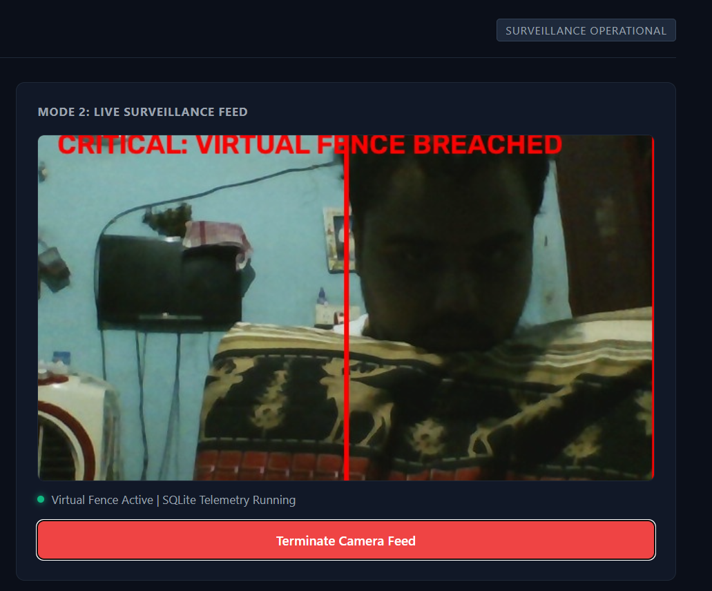
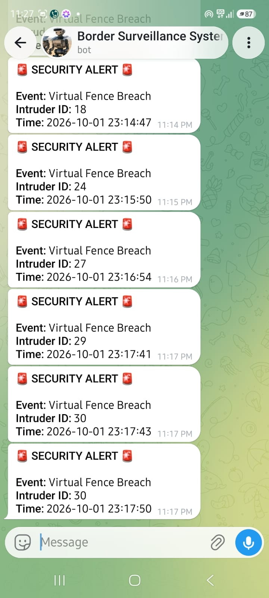

# Video Classification & Surveillance Using Deep Learning

This project implements a Deep Learning-based video classification and surveillance system. It includes capabilities for action recognition, hybrid inference, dossier generation, and a live surveillance mode with an interactive virtual fence.

## Features
- **Deep Learning Video Classification**: Classifies videos into 7 different categories using PyTorch, LSTM, and other deep learning techniques.
- **Hybrid Inference & Analytics**: Leverages advanced models like YOLOv8 and CLIP for object detection and tracking.
- **Live Surveillance Mode (Mode 2)**: Real-time surveillance featuring a **Virtual Fence**.
- **Telegram Bot Integration**: Automatically sends alert messages when someone breaches the virtual fence in Live Surveillance Mode.
- **Automated Dossier Generation**: Automatically generates detailed PDF reports and plots analyzing the video inferences.

## Screenshots

### Mode 1: Forensic Video Upload


### Mode 2: Live Surveillance Feed & Virtual Fence


### Telegram Bot Alerts



## Performance Metrics
- **Test Accuracy**: Achieved a massive global peak testing accuracy of **99.05%** on the unseen holdout videos.
- **Precision & Recall**: Critical security classes like Violence, Wildlife, and Traffic achieved flawless 1.0000 Precision and Recall scores.

## Dataset Details
The model is trained on a meticulously curated dataset containing exactly **1050 unique videos** across 7 classes (150 videos per class):

- **Traffic (150 Videos)**: Filtered from the [Traffic Video Dataset](https://www.kaggle.com/datasets/arshadrahmanziban/traffic-video-dataset) (originally 254 videos). A script was run to keep only the highest quality/least blurry videos.
- **Wildlife (150 Videos)**: Extracted from the massive 30K+ [Animal-Kingdom Dataset](https://github.com/sutdcv/Animal-Kingdom). Sourced automatically using the included `wildlife_extractor.py` script.
- **Violence (150 Videos)**: Manually dragged and dropped from the [Real Life Violence Situations Dataset](https://www.kaggle.com/datasets/mohamedmustafa/real-life-violence-situations-dataset) (originally 1000 videos).
- **Education, Entertainment, Human Activities, and Sports (600 Videos total, 150 each)**: Selected from the [UCF101 Dataset](https://www.kaggle.com/datasets/pevogam/ucf101) by running the `dataset_extractor.py` script to collect these remaining 4 classes.

## Prerequisites & Installation

1. **Clone the repository**:
   ```bash
   git clone <your-github-repo-url>
   cd <your-repo-name>
   ```

2. **Install the required packages**:
   It is recommended to use a virtual environment.
   ```bash
   pip install -r requirements.txt
   ```

3. **Download Required Weights**:
   You do not need to hunt for the model weights manually! Simply run the included script to safely download all necessary weights (YOLOv8, Torchvision, EasyOCR, MTCNN) directly into your project:
   ```bash
   python force_download.py
   ```

## Running the Application

**Start the Web Interface:**
To start the Flask web application, simply run:
```bash
python app.py
```
Then, access the interface through your web browser at `http://127.0.0.1:5000`.

**Generate the AI Dossier:**
To automatically create the professional PDF report detailing model architecture and testing metrics, run:
```bash
python generate_dossier.py
```
This will output `SIH_Civilian_Safety_Dossier.pdf` into your main folder.

## Project Structure
- `app.py`: Main Flask application.
- `train_lstm.py`: Model training script utilizing LSTM networks.
- `hybrid_inference.py`: Runs complex inference blending multiple deep learning models.
- `generate_dossier.py` / `generate_dossier_plots.py`: Scripts to generate PDF reports and data plots.
- `dataset_extractor.py` / `wildlife_extractor.py` / `traffic_extractor.py`: Utility scripts that were used to build and curate the custom dataset.
