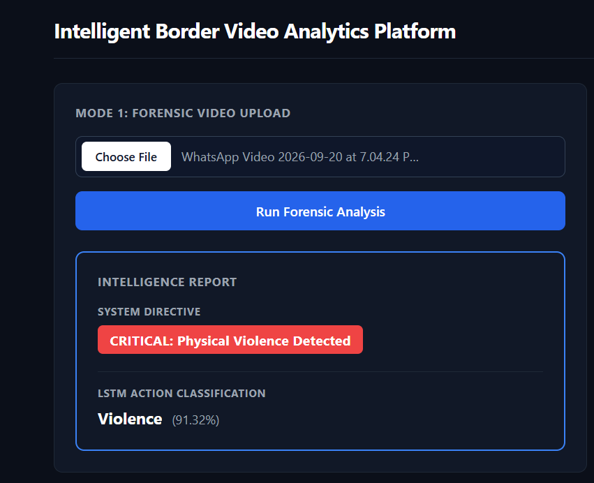

# Video Classification & Surveillance Using Deep Learning

This project implements a Deep Learning-based video classification and surveillance system. It includes capabilities for action recognition, hybrid inference, dossier generation, and a live surveillance mode with an interactive virtual fence.

## Features
- **Deep Learning Video Classification**: Classifies videos into 7 different categories using PyTorch, LSTM, and other deep learning techniques.
- **Hybrid Inference & Analytics**: Leverages advanced models like YOLOv8 and CLIP for object detection and tracking.
- **Live Surveillance Mode (Mode 2)**: Real-time surveillance featuring a **Virtual Fence**.
- **Telegram Bot Integration**: Automatically sends alert messages when someone breaches the virtual fence in Live Surveillance Mode.
- **Automated Dossier Generation**: Automatically generates detailed PDF reports and plots analyzing the video inferences.

## Screenshots

### Mode 1: Forensic Video Upload


### Mode 2: Live Surveillance Feed & Virtual Fence


### Telegram Bot Alerts


## Performance Metrics
- **Test Accuracy**: Achieved a robust, generalized peak testing accuracy of **98.10% (206/210 correct)** on unseen holdout videos.
- **Macro AUC & Sensitivity**: Recorded a **0.9983 Macro AUC** and **0.9810 Macro Sensitivity/Recall**, demonstrating strong discriminative separation across all 7 classes.
- **Precision & Recall**: Education, Entertainment, and Wildlife achieved flawless **1.0000** Precision and Recall scores, with **0.9667+** across Traffic, Violence, Human Activities, and Sports.
- **Zero Dataset Bias**: Evaluated on a diverse dataset (dashcam, drone, and street traffic; letterbox aspect-ratio preservation for violence), completely eliminating static CCTV background memorization.

## Dataset Details
The model is trained on a meticulously curated dataset containing exactly **1050 unique videos** across 7 classes (150 videos per class):

- **Traffic (150 Videos)**: Sourced across diverse perspectives (dashcam, aerial drone, and urban street traffic) using the included YouTube video scraper script (`scrape_traffic.py`) to eliminate environmental background and CCTV domain-shift bias.
- **Wildlife (150 Videos)**: Extracted from the massive 30K+ [Animal-Kingdom Dataset](https://github.com/sutdcv/Animal-Kingdom). Sourced automatically using the included `wildlife_extractor.py` script.
- **Violence (150 Videos)**: Curated from the [Real Life Violence Situations Dataset](https://www.kaggle.com/datasets/mohamedmustafa/real-life-violence-situations-dataset) with aspect-ratio letterbox padding.
- **Education, Entertainment, Human Activities, and Sports (600 Videos total, 150 each)**: Selected from the [UCF101 Dataset](https://www.kaggle.com/datasets/pevogam/ucf101) by running the `dataset_extractor.py` script to collect these remaining 4 classes.

## Prerequisites & Installation

1. **Clone the repository**:
   ```bash
   git clone https://github.com/yashwant-projects/Video-Classification-Using-Deep-Learning.git
   cd Video-Classification-Using-Deep-Learning
   ```

2. **Install the required packages**:
   It is recommended to use a virtual environment.
   ```bash
   pip install -r requirements.txt
   ```

3. **Download Custom Bi-LSTM Model Weights**:
   Due to GitHub file size limits, the custom trained model checkpoint (98.10% accuracy) is hosted via GitHub Releases. 
   - Download the model here: [sih_lstm_model.pth](https://github.com/yashwant-projects/Video-Classification-Using-Deep-Learning/releases/download/v1.0/sih_lstm_model.pth)
   - Place the downloaded `sih_lstm_model.pth` inside the `models/` directory in this project.
   *(Standard pre-trained YOLOv8 weights and OpenAI CLIP ViT-B/32 will automatically download on-demand on first run).*

## Running the Application

**Start the Web Interface:**
To start the Flask web application, simply run:
```bash
python app.py
```
Then, access the interface through your web browser at `http://127.0.0.1:5000`.

**Generate the AI Dossier:**
To automatically create the professional PDF report detailing model architecture and testing metrics, run:
```bash
python generate_dossier.py
```
This will output `SIH_Civilian_Safety_Dossier.pdf` into your main folder.

## Project Structure
- `app.py`: Central Flask web application powering Mode 1 (Forensic Video Upload) and Mode 2 (Live Surveillance with Virtual Fence).
- `train_lstm.py`: Training script for the Bi-LSTM model with Temporal Attention and Tri-Pooling.
- `evaluate_model.py`: Computes test evaluation diagnostics (classification report, 98.10% accuracy, and confusion matrix).
- `hybrid_inference.py`: Production inference engine blending YOLOv8 spatial tracking, CLIP ViT-B/32, and the Bi-LSTM classifier.
- `extract_frames.py`: Converts raw MP4s into 16 YOLO-gated frames with aspect-ratio letterboxing.
- `extract_features.py`: Serializes extracted frames into 512-dim CLIP embeddings (`.npy`).
- `scrape_traffic.py`: YouTube video scraper for curating the diverse traffic video dataset using `yt-dlp`.
- `generate_dossier.py` / `generate_dossier_plots.py`: Scripts to generate the executive PDF intelligence dossier and evaluation plots.
- `generate_design_diagrams.py` / `build_presentation.py`: Generates high-resolution architectural diagrams and compiles the complete 22-slide university review presentation deck.
- `dataset_extractor.py` / `wildlife_extractor.py` / `traffic_extractor.py`: Utility scripts used to curate and preprocess the 1,050-video dataset.
